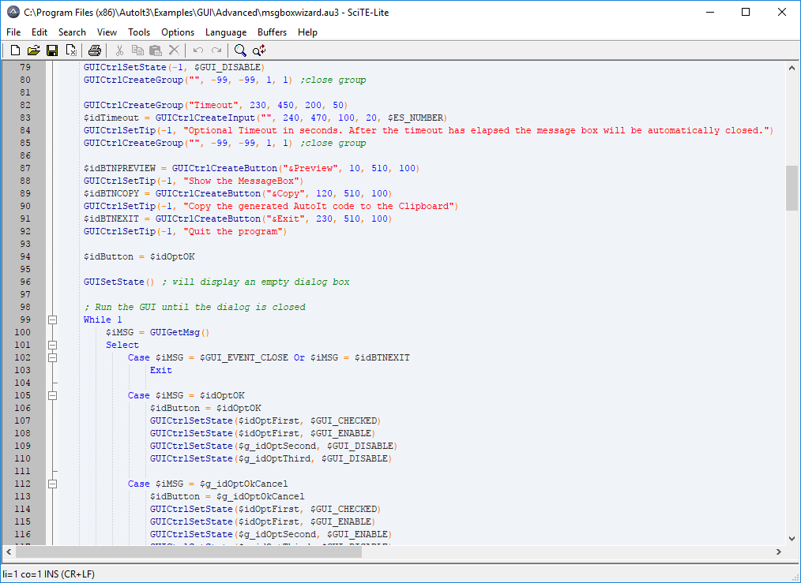
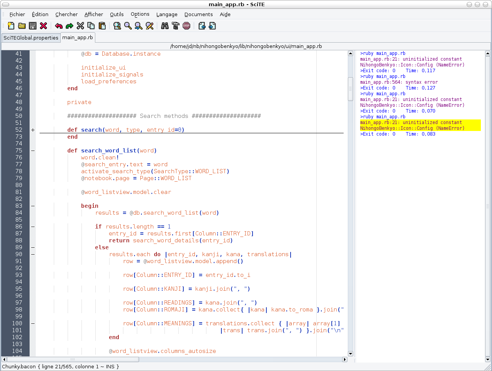

[](https://github.com/scite-research-assistant/scite-ai/releases/)

# scite AI Research Evidence and Citation Platform

scite AI is a research platform that helps scientists discover, evaluate, and verify scholarly literature.

It combines citation-context analysis, AI-assisted research, manuscript reference checking, and literature discovery in one workflow.

The platform is designed to show how later publications use earlier research and whether cited claims are supported, contrasted, or simply mentioned.

## Project Snapshot

| Property | Value |
| --- | --- |
| Product | scite AI |
| Product type | AI-powered scholarly research platform |
| Main workflows | Search, citation analysis, reference checking, research assistance |
| Primary users | Researchers, students, publishers, and research teams |
| Citation data | Citation statements from scholarly publications |
| Access model | Hosted web platform |
| Parent company | Research Solutions |
| Public repository | No public core product repository confirmed |



## Research Discovery

scite AI helps users find academic literature through research-oriented search workflows.

A research session can be used to:

- Search for scholarly publications
- Explore citation relationships
- Locate papers related to a claim
- Review citation contexts
- Compare how later studies use a source
- Identify supporting or conflicting evidence
- Follow references across a literature landscape
- Build a focused reading list
- Inspect source metadata
- Prepare evidence for a literature review

The platform is intended to reduce the time required to move from a research question to a reviewable set of sources.

## Smart Citations

Smart Citations analyze the context in which a publication is cited by later work.

Instead of showing only a citation count, the platform classifies citation statements according to their apparent relationship with the cited claim.

Typical categories include:

```text
supporting
contrasting
mentioning
```

These labels help users distinguish between:

- A study that confirms or supports a result
- A study that challenges or contradicts a result
- A study that cites a source without directly evaluating its findings

Smart Citations are intended as evidence for further reading. They should be checked against the original papers and the surrounding research context.

## Citation Context

Citation context provides the text surrounding a reference in a citing publication.

This can help users understand:

- Why a paper was cited
- Which result was discussed
- Whether a claim was reproduced
- Whether a limitation was highlighted
- Whether a source was used as background
- Whether later research disagreed with the original conclusion
- Whether a citation is relevant to a manuscript argument

Contextual analysis is more informative than a raw citation count, but it does not replace expert reading or methodological review.

## scite Assistant

scite Assistant is a conversational research tool that uses scholarly literature as a source for answers.

It can support tasks such as:

- Explaining a research topic
- Finding relevant literature
- Comparing published findings
- Summarizing evidence
- Identifying conflicting conclusions
- Locating citation statements
- Drafting research questions
- Exploring a paper's influence
- Finding papers that support or challenge a claim

Answers should be verified against the linked publications, especially when the topic is technical, medical, legal, or otherwise high stakes.

## Reference Check

Reference Check reviews references in manuscripts and research documents.

It can help identify:

- Retracted publications
- Expressions of concern
- Missing or inconsistent metadata
- Suspicious references
- Citation mismatches
- Conflicting evidence
- References that require closer inspection
- Sources that may no longer support a manuscript claim

Reference checking is useful before submission, peer review, publication, or internal research approval.



## Research Integrity

Citation analysis is one part of research integrity.

A responsible workflow should include:

- Reading the original source
- Checking the publication date
- Reviewing corrections and retractions
- Inspecting the cited passage
- Comparing methods and datasets
- Distinguishing evidence from interpretation
- Checking whether a result was replicated
- Recording uncertainty
- Avoiding unsupported conclusions
- Keeping a traceable bibliography

scite AI can surface useful evidence, but researchers remain responsible for interpreting the literature accurately.

## Literature Review Workflows

The platform can support several stages of a literature review.

### Topic Exploration

Use broad searches to identify terminology, landmark publications, research groups, and competing explanations.

### Evidence Screening

Review citation statements and publication context to determine which papers deserve closer reading.

### Claim Verification

Search for later studies that support, challenge, or qualify a claim.

### Manuscript Preparation

Check references before submitting a paper, report, thesis, or systematic review.

### Ongoing Monitoring

Return to a topic as new publications appear and update the evidence base over time.

## Citation Index

The citation index connects scholarly publications through their references and citation statements.

It can help users:

- Trace the development of an idea
- Identify influential publications
- Find newer work that cites a source
- Detect clusters of related studies
- Compare citation activity across papers
- Discover research that disputes an established result
- Locate evidence around a specific claim

Index coverage and classification quality may vary between disciplines, publishers, document types, and publication dates.

## Scholarly Sources

The platform works with scholarly literature such as:

- Journal articles
- Conference papers
- Preprints
- Reviews
- Research reports
- Datasets
- Technical publications
- Other indexed scholarly documents

Source availability depends on publication metadata, indexing coverage, access rights, and the provider's source collection.

## Browser and Research Integrations

scite AI is designed to fit into existing literature workflows.

Common integration scenarios include:

- Reviewing papers while browsing
- Checking citations during manuscript writing
- Exploring references from scholarly search tools
- Connecting research notes to source evidence
- Checking references in a citation manager
- Moving from a search result to a citation context
- Comparing evidence across multiple publications

Integrations may change over time as external services and browser platforms evolve.

## Data Interpretation

Citation classifications should be treated as signals for investigation.

A supporting classification does not prove that a result is correct.

A contrasting classification does not automatically invalidate a source.

A mentioning classification may still be useful for understanding terminology, historical context, or research lineage.

Researchers should inspect:

- The cited sentence
- The surrounding paragraph
- The methods section
- The sample or dataset
- The statistical analysis
- The limitations
- The publication history
- Later corrections or retractions

## Platform Boundaries

scite AI is a hosted research service rather than a self-hosted open-source application.

Users should account for:

- Account and subscription requirements
- Provider availability
- Index coverage
- Document access restrictions
- Data retention policies
- Institutional licensing
- Export limitations
- Model-generated summaries
- Changes to third-party integrations

Sensitive unpublished manuscripts should only be uploaded when the applicable organizational and contractual policies permit it.

## Research Agent Reference Material

The supplied local reference set contains files from GPT Researcher, an adjacent open-source research-agent project.

These files are structural references for research workflows and are not scite AI source code.

The local entry point is [main.py](./main.py).

Dependency metadata is represented by [requirements.txt](./requirements.txt), while deployment configuration includes [docker-compose.yml](./docker-compose.yml), [Procfile](./Procfile), and [render.yaml](./render.yaml).

The local agent configuration is represented by [langgraph.json](./langgraph.json).

## Multi-Agent Research References

The provided reference implementation contains a multi-agent workflow.

The main entry point is [multi_agents/main.py](./multi_agents/main.py).

Research roles are represented by [multi_agents/agents/researcher.py](./multi_agents/agents/researcher.py), while factual validation is represented by [multi_agents/agents/fact_checker.py](./multi_agents/agents/fact_checker.py).

Writing and publication stages are represented by [multi_agents/agents/writer.py](./multi_agents/agents/writer.py) and [multi_agents/agents/publisher.py](./multi_agents/agents/publisher.py).

File-format handling is available in [multi_agents/agents/utils/file_formats.py](./multi_agents/agents/utils/file_formats.py).

The local MCP reference documentation is available in [mcp-server/README.md](./mcp-server/README.md).

## Skills and Automation References

The supplied workspace also contains a research-agent skill definition in [skills/gpt-researcher/SKILL.md](./skills/gpt-researcher/SKILL.md).

Infrastructure examples are represented by [terraform/main.tf](./terraform/main.tf).

These files document adjacent implementation patterns for research automation and should not be interpreted as scite AI implementation files.

## Research Assistant Comparisons

scite AI focuses on scholarly citation context and evidence classification.

Other research assistants may focus on:

- General web research
- Autonomous browsing
- Literature search
- Dataset extraction
- Citation graph exploration
- Manuscript drafting
- Reference validation
- Multi-agent report generation

The right tool depends on whether the task prioritizes citation evidence, broad web coverage, local documents, structured extraction, or manuscript integrity.

## Limitations

AI-assisted research can produce incomplete or misleading results.

Potential limitations include:

- Incomplete source coverage
- Incorrect interpretation of citation context
- Missing retractions
- Delayed indexing
- Ambiguous language
- Inconsistent metadata
- Discipline-specific terminology
- Paywalled source content
- Preprint and version confusion
- Model-generated summaries that omit caveats

Users should treat generated answers as research aids and verify important claims directly.

## Privacy and Security

Before using a hosted research platform, review:

- Account security
- Workspace access
- Document upload policies
- Institutional requirements
- Data retention
- Export behavior
- Third-party integrations
- Browser extension permissions
- Manuscript confidentiality

Do not upload confidential or unpublished material unless the service and the user's organization explicitly allow it.

## Contributing and Feedback

The core scite AI service does not have a confirmed public source repository.

Feedback, product questions, and research workflow requests should be directed through the official support channels associated with the service.

The adjacent local reference files can be used for studying open research-agent architecture, citation workflows, and evidence-oriented automation.

## Company Information

scite was founded as a research technology company and is now associated with Research Solutions.

The service is used for scholarly discovery, citation analysis, manuscript checking, and evidence evaluation.

Company address: Not confirmed.

## Disclaimer

scite AI is a research support tool.

It does not replace peer review, domain expertise, statistical analysis, systematic review protocols, or professional advice.

Researchers should verify important claims using original publications and established research-integrity practices.

## Related Search Terms

scite ai, scite assistant, scite research assistant, scite smart citations, scite citation index, research-assistant, scholarly-search, citation-analysis, literature-review, research-integrity, reference-checker, academic-research, scientific-literature, retraction-checker, ai-research
